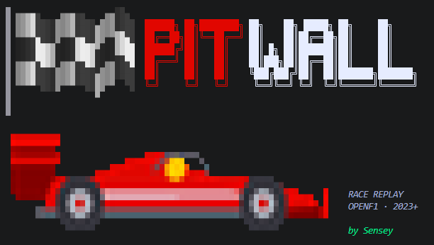
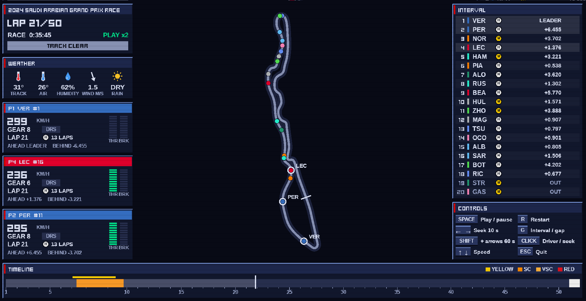
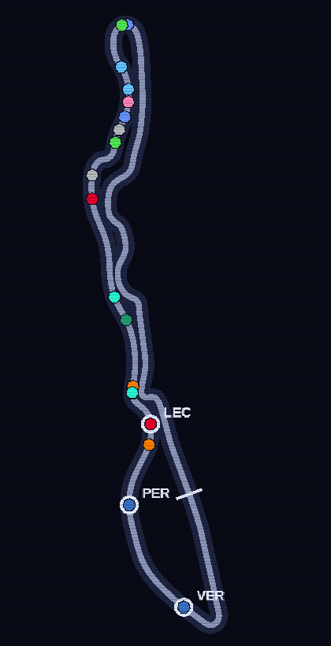
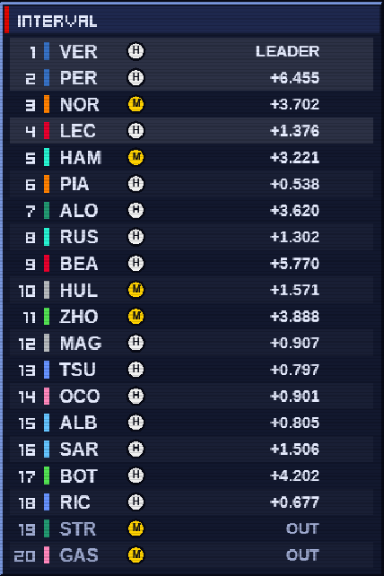
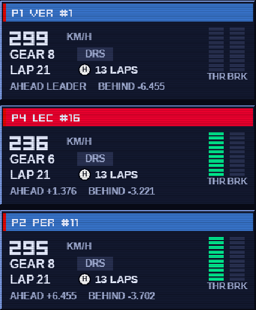
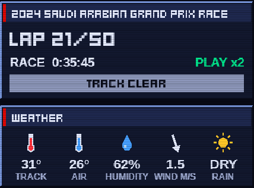
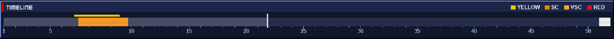
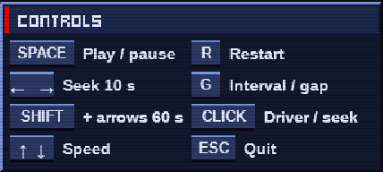

# PIT-WALL



**Replay any Formula 1 race from 2023 onwards on your desktop, the way a pit wall engineer watches it.**
Cars on the track map, live classification, driver telemetry, flags, weather, all rebuilt from open timing data.



---

## Why I built this

I love watching Formula 1. Every race weekend I am in front of the screen, and one question kept coming back while the race unfolded:

> Why do they change tyres, how and why do tyres wear out during a race, and how much does a pit stop really shape a driver's result?

In other words: **what is the real weight of tyre choice and pit strategy in winning a Grand Prix?**

I kept telling myself I would dig through the internet to understand it properly, and I never found the time. My favourite driver is Lewis Hamilton, and with Ferrari things are not exactly going his way at the moment. Every questionable strategy call on the radio made the question sharper.

I am also a machine learning student, passionate about AI and software. I wanted a project that would be intellectually demanding but fun enough to keep me hooked for months. Rebuilding the pit wall myself, with real data, ticked both boxes. This is it.

---

## Contents

- [A race, replayed](#a-race-replayed)
- [Tour of the screen](#tour-of-the-screen)
- [Getting started](#getting-started)
- [Under the hood](#under-the-hood)
- [Project structure](#project-structure)
- [Data notes](#data-notes)
- [What the replay does not tell you](#what-the-replay-does-not-tell-you)

---

## A race, replayed

The screenshot above is the **2024 Saudi Arabian Grand Prix**, lap 21. Verstappen leads, Perez follows, and in ninth place sits a certain Oliver Bearman, 18 years old, called up by Ferrari the day before to replace Carlos Sainz. The orange block on the timeline is the safety car after Stroll's crash on lap 7. The leaderboard already shows who used it to pit for hards (**H**) and who stayed out on mediums (**M**).

That is the whole idea: one window where you can *see* a strategy play out.

It starts in the terminal:

```
python -m pit_wall.replay_app
```

A small menu lets you pick a season, a Grand Prix and a session (Race or Sprint). Every step has a **Back** entry, the first one has **Exit**, and the key hints stay on screen (`↑↓ move · Enter select · Ctrl+C quit`). The chequered flag waves for a second, then the replay window opens.

---

## Tour of the screen

### Track map



The circuit outline comes from the fastest lap of the race. Every car is a dot in its team colour, moving smoothly at 60 fps even though the data comes at 4 Hz (two frames are blended). Followed drivers get a white ring and their name.

The track itself changes colour with the race status: grey when clear, yellow, orange for the safety car, red for a red flag. Cars in the pit lane fade out, retired cars disappear.

<br clear="right">

### Leaderboard



Position, team stripe, driver code, current tyre compound and the gap, either **interval** to the car ahead or **gap to the leader** (press `G`). Badges on the right tell the story of each car: `DRS` open, `PIT`, `FIN` at the flag, `OUT` when retired, `+1 LAP` for lapped cars.

Click a row to open or close that driver's card.

<br clear="right">

### Driver cards



Up to three drivers followed at once, the podium of the start by default. Each card shows speed, gear, DRS, lap, tyre compound and age, the gap to the car ahead and to the car behind, and two segmented bars for **throttle** (green) and **brake** (red), straight from the car telemetry.

<br clear="right">

### Race header and weather



Current lap over race distance, race clock, playback speed and a status band (`TRACK CLEAR`, `SAFETY CAR`, `VIRTUAL SC`, `RED FLAG`, `CHEQUERED`).

Below it, the weather: track and air temperature, humidity, wind speed with an arrow pointing where the wind blows, and dry or wet. Track temperature matters more than it looks, keep an eye on it.

<br clear="right">

### Timeline



The whole race on one bar. Coloured blocks are safety car, virtual safety car and red flag periods, the thin yellow strip above marks sector yellow flags, ticks are the leader's laps. Click or drag anywhere to jump in the race.

### Controls



| Key | Action |
|---|---|
| `SPACE` | Play / pause |
| `←` `→` | Seek 10 s (hold `SHIFT` for 60 s) |
| `↑` `↓` | Playback speed, x0.5 to x64 |
| `R` | Restart |
| `G` | Interval or gap to leader |
| Click | Leaderboard row: driver card. Timeline: seek |
| `ESC` | Quit |

---

## Getting started

Requires **Python 3.13** (Arcade dependencies have no 3.14 wheels yet).

```
py -3.13 -m venv .venv
.venv\Scripts\activate
pip install -r requirements.txt
python -m pit_wall.replay_app
```

The first time you open a race, its telemetry is downloaded from OpenF1 (around 1 to 2 minutes, the API serves about one request per second). After that the race lives in the local cache and opens in a few seconds.

Tests:

```
python -m pytest
```

---

## Under the hood

### From raw timing to frames

The heart of the project is `pit_wall/core`, pure analysis with no UI import. It turns OpenF1 endpoints into normalized pandas DataFrames, then puts every layer of a race on one shared clock: one frame every 0.25 s.

```python
from pit_wall.core.replay import build_replay

replay = build_replay(session_key=9480)  # 2024 Saudi Arabian GP, Race
replay["cars"].columns
# frame, date, driver_number, x, y, speed, throttle, brake, n_gear, drs, lap,
# position, gap_to_leader, interval, laps_down, compound, tyre_age, status
```

`build_replay` returns plain DataFrames: `drivers`, `cars`, `leader_laps`, `track_status`, `sector_flags`, `outline`, `weather`. The Arcade window only indexes them by frame, it never computes race logic, so the same output can feed any other front end.

Positions are interpolated between GPS samples, while discrete channels (gear, DRS) take the nearest sample, so a car never shows gear 5.5:

```python
frames["x"] = np.interp(t_grid, t_tel, tel["x"])
frames["y"] = np.interp(t_grid, t_tel, tel["y"])
frames = pd.merge_asof(frames, tel[["date", *CAR_CHANNELS]], on="date", direction="nearest")
```

Race control messages become a track status with a single vectorized `np.select`. The virtual safety car is tested first, since its message also contains "SAFETY CAR DEPLOYED":

```python
status = np.select(
    [
        msg.str.contains("VIRTUAL SAFETY CAR DEPLOYED"),
        msg.str.contains("SAFETY CAR DEPLOYED"),
        msg.str.contains("VIRTUAL SAFETY CAR ENDING"),
        flag.eq("RED"),
        flag.eq("CHEQUERED"),
        track_wide & flag.isin(["YELLOW", "DOUBLE YELLOW"]),
        track_wide & flag.isin(["GREEN", "CLEAR"]),
    ],
    ["VSC", "SC", "GREEN", "RED", "CHEQUERED", "YELLOW", "GREEN"],
    default="",
)
```

### The window

`pit_wall/replay_app` reshapes the frames once into `(frame, driver)` numpy arrays, so drawing a frame is plain indexing. Text goes through a pool of reusable `arcade.Text` objects drawn in one batch, which keeps the window smooth with hundreds of labels.

The look is a nod to the PS2 era: bevelled navy panels, pixel font titles, light CRT scanlines. The terminal banner uses half block characters (`▀`): each cell carries two pixels in true colour, which is how a pixel art car and a waving flag fit in a terminal.

### Lap comparison engine

`pit_wall/core/telemetry.py` compares the fastest laps of two drivers: speed, throttle, brake and gear over distance, cumulative delta time anchored on the official sector lines, and the fastest driver per mini sector.

---

## Project structure

```
f1_ml_project/
  pit_wall/
    core/                 # pure analysis, no UI imports, returns DataFrames or dicts
      ingestion.py        # OpenF1 REST loading, local HTTP cache, normalized DataFrames
      telemetry.py        # fastest lap comparison, delta time, mini sectors
      replay.py           # race replay frames: cars, track status, sector flags, outline, weather
    replay_app/           # Arcade race replay, draws core outputs only
      __main__.py         # entry point: banner, menu, loading, window
      banner.py           # terminal banner (pixel art car, waving flag)
      menu.py             # season / Grand Prix / session menu with back and exit
      scene.py            # frames reshaped to (frame, driver) arrays
      window.py           # layout, playback clock, keyboard and mouse
      widgets.py          # track map, leaderboard, cards, weather, timeline, controls
      theme.py, icons.py  # palette, fonts, panels, vector icons
  tests/                  # pytest on synthetic data, no network
  assets/                 # README screenshots
  cache/                  # HTTP cache (git ignored)
```

---

## Data notes

All data comes from the [OpenF1 API](https://openf1.org): free, no account, 2023 onwards, non commercial use. FastF1 is not used: since October 2026, F1 live timing requires an F1TV account even for past sessions.

Open data is great, and also a bit messy. A few things the core handles so the replay stays honest:

- **Cool down lap.** OpenF1 lists the lap after the chequered flag. It is dropped, otherwise the counter reads 59/58 and nobody finishes.
- **Misdated laps.** In Australia 2023, Leclerc's only lap is dated at the end of the race although he crashed on lap 1. A car is considered stopped at its last movement at the latest.
- **Missing pit data.** Some races have no pit records at all. Everything still builds, the `PIT` badge just never shows.
- **Timing jitter.** Lap starts and start plus duration can disagree by a few tenths, the core allows one second of tolerance.

---

## What the replay does not tell you

Watch Jeddah 2024 again and stop on lap 7. The safety car comes out, half the field dives into the pits for hards, the other half stays out on mediums. Twenty laps later the order has reshuffled.

The replay shows *what* happened, frame by frame. It does not yet say *why*: how fast those mediums were falling apart, what the stop really cost, what staying out two more laps would have changed.

Those are exactly the questions that started this project. The pit wall is now in place, with every frame of every race on one clock, ready for the answers.

---

<p align="center"><b>Made with passion by Sensey</b></p>
